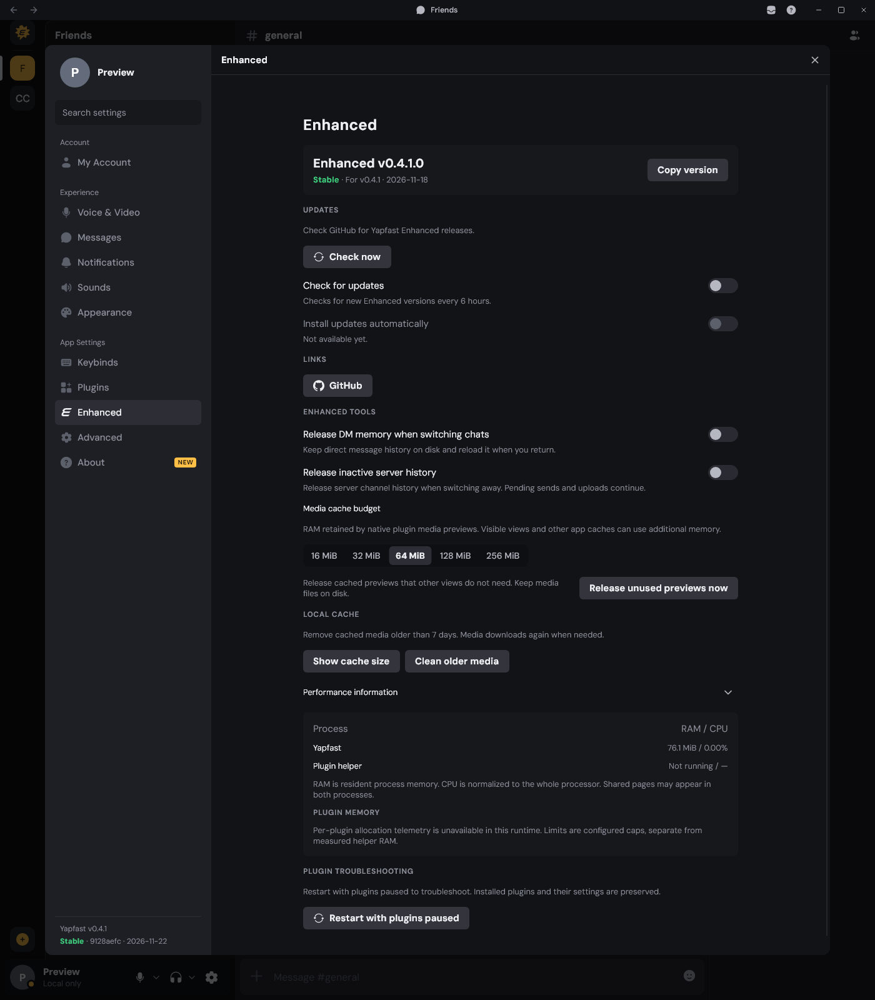

  

<h1 align="center">Yapfast Enhanced</h1>

  Native plugin support for Yapfast. 
  Install, manage and run WebAssembly plugins from inside the app.

  <a href="https://github.com/dmor-me/Yapfast-Enhanced/releases/tag/v0.4.1.0"><strong>Download for Windows</strong></a>
  &nbsp;·&nbsp;
  <a href="#installation">Installation</a>
  &nbsp;·&nbsp;
  <a href="docs/plugins/README.md">Plugin development</a>
  &nbsp;·&nbsp;
  <a href="https://github.com/dmor-me/Yapfast-Enhanced/issues">Report an issue</a>

**Enhanced v0.4.1.0** supports **official Yapfast v0.4.1 on Windows 11 x64**.
Download links become available when a matching Windows release is published.
The source can be built independently using the instructions below.

## What is Yapfast Enhanced?

Yapfast Enhanced extends Yapfast's native Rust/Slint application with a plugin
manager and an Extism/WebAssembly runtime. The installer adds the compatible
Enhanced build to your existing Yapfast installation. You continue using your
usual shortcut, accounts and settings.

The integration builds on
[blockgameentity/yapfast's plugin branch](https://github.com/blockgameentity/yapfast/tree/feat/plugins).
Yapfast itself is developed by the
[upstream Yapfast project](https://github.com/yapfast/yapfast).

## Features

- An in-app plugin manager with Marketplace, Installed and Add from URL.
- A [GitHub-hosted marketplace](https://github.com/dmor-me/yapfast-plugin-registry)
  with reviewed, commit-pinned listings.
- Installation from supported HTTPS Git repositories, including GitHub and
  Codeberg, plus local plugin imports.
- Enable, disable, update, roll back and uninstall plugins.
- Persistent plugin settings, data and permission grants.
- Capability and network-host permission controls, integrity checks and recent logs.
- Native media-browser support for plugins such as Favorite GIF Folders.
- An Enhanced settings page with manual and optional six-hour release checks.
- Optional DM and server-history memory release, a native plugin preview budget,
  unused-preview release and cleanup of older cached media.
- Process resource readings and restart controls for troubleshooting plugins.

Plugins target Yapfast's plugin manifest and API. See the
[plugin development guide](docs/plugins/README.md) and the
[Ping example](plugins/ping/README.md) to get started.

## Screenshots and quick tour

Captured from **Enhanced 0.4.1.0** using a separate local demo profile.
No real account or conversations are shown.

### Enhanced settings and memory tools

Open **Settings → Enhanced** to check your version, check GitHub for updates,
and adjust the optional memory tools. DM and server-history release are off
by default; enable them to release history from RAM when switching away while
keeping the disk cache. The preview budget controls native plugin media previews.

See performance information and plugin troubleshooting

Open **Performance information** to view application and plugin-helper RAM/CPU
readings. These are live process readings, not per-plugin measurements or
promised memory usage. This demo has no plugins running.
Use **Restart with plugins paused** when troubleshooting; plugin settings are kept.

To install a plugin, open **Settings → Plugins**, choose **Marketplace** or
**Add from URL**, review its permissions and install it. Manage enabled plugins
under **Installed**. For local packages, use **Advanced → Install from file**.
See the [plugin guide](docs/plugins/README.md) for supported APIs and examples.

## Installer choices

- [Universal online installer](https://github.com/dmor-me/Yapfast-Enhanced/releases/download/v0.4.1.0/Yapfast-Enhanced-Universal-Installer.exe): detects your exact Yapfast build and opens its matching verified installer.
- [Version-specific offline installer](https://github.com/dmor-me/Yapfast-Enhanced/releases/tag/v0.4.1.0): for official Yapfast 0.4.1.

The universal installer requires internet and published compatibility releases.
Unsupported builds stay unchanged. [How detection and verification work](docs/universal-installer.md).

## Installation

### Supported Windows build

This package supports **Windows 11 x64 with official Yapfast 0.4.1 x64**.
The installer checks the exact supported executable fingerprint.
Each future Yapfast release requires a matching Enhanced compatibility build.

1. Install the supported official version of
   [Yapfast](https://github.com/yapfast/yapfast/releases).
2. Download `Yapfast-Enhanced-Installer.exe` from
   [Enhanced Releases](https://github.com/dmor-me/Yapfast-Enhanced/releases).
3. Finish active calls and uploads. Setup will close Yapfast automatically.
4. Run the installer and select the folder containing `yapfast.exe`.
   The usual location is `%LOCALAPPDATA%\Programs\Yapfast`.
5. Launch Yapfast using your usual shortcut and open **Settings → Plugins**.

The installer keeps a verified backup for restoration. Release downloads include
`SHA256SUMS.txt` for checking file integrity. Current development installers are
unsigned.

See the [Windows installation guide](docs/enhanced-inplace.md) for compatibility,
recovery and restoration details.

### Installing plugins

Use **Marketplace** for the maintained catalog, or paste a plugin's Git
repository address under **Add from URL**, such as
`https://github.com/owner/yapfast-plugin`.
For local packages, use **Advanced → Install from file**.
Review the requested permissions and enable the plugin.

Favorite GIF Folders is a separate plugin installed through the plugin manager.
This source tree includes the small Ping example.

## Updates and restoration

Check **Settings → Enhanced → Check now** for Enhanced releases.
Enable **Check for updates** for checks every six hours while Yapfast runs.
Automatic Enhanced update installation is planned for a future version.

Official Yapfast updates require a matching Enhanced compatibility package to
continue running plugins. If a matching package is unavailable, the verified
official update can proceed and plugin support pauses until a compatible
Enhanced package is installed.

To restore the supported original executable, open **Windows Settings → Apps →
Installed apps → Yapfast Enhanced → Uninstall**. Account and plugin data are
preserved. See the [restoration guide](docs/enhanced-inplace.md#restore).

## Source and building

This repository contains the Enhanced application source, plugin API, runtime
helper, installer manager, Slint UI, vendored patches and packaging scripts.

- [Native build instructions](docs/building.md#windows)
- [Enhanced build and release guide](docs/releasing-enhanced.md)
- [Changelog](CHANGELOG.md)
- [Attribution and dependency notices](NOTICE.md)
- [Enhanced settings and tools](docs/enhanced-tools.md)
- [Architecture](docs/architecture.md)
- [Plugin API and SDKs](docs/plugins/README.md)
- [Contributing](CONTRIBUTING.md)
- [Experimental module-loader prototype](tools/yapfast-enhanced-loader/README.md) (development only)
- [Documentation index](docs/README.md)

The application source is in `src/`, `ui/` and `crates/`. Plugin authors can use
the SDKs in `pdk/`, the manifest schemas in `schemas/`, and the Ping example in
`plugins/`. Windows packaging lives in `packaging/windows/` and `scripts/`.
Local build caches and installer outputs are excluded from source publication.

Build the application and `yapfast-plugins.exe` helper together. The installer
also includes `yapfast-enhanced-manager.exe`, built from
`tools/yapfast-enhanced-manager`.

## Credits and license

Yapfast Enhanced includes upstream Yapfast and the plugin implementation from
`blockgameentity/yapfast` at commit
`cb31511cb33337925a777fec9c05e52399634924`.
Their authors retain their credits and copyright notices.

Yapfast Enhanced is distributed under **GPL-3.0-or-later**.
See [LICENSE](LICENSE). Vendored dependencies retain their own licenses and
notices in their respective directories.
